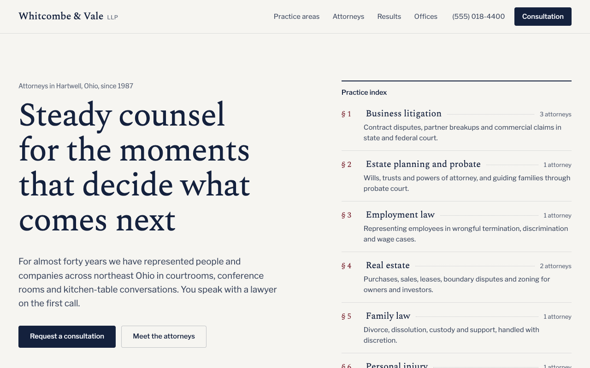

# Whitcombe & Vale: law firm website template

A composed, typographic website for a small law firm, with practice areas, attorney bios, sample case results, office details and a consultation request form. Built with Astro as a fully static site.



[](https://console.cloudzyro.com/new?repo=https://github.com/Cloudzyro/template-law-firm)

## What's included

- Home page with a practice index (each area numbered with a section mark), how the firm works, attorneys, recent results and a call to action
- Practice area pages: matters handled, common questions, related results and the attorneys who practice there
- Attorney pages with a bio, education, bar admissions, memberships and direct contact details
- Case results page with a filter by practice area and a clear "sample results" notice and disclaimer
- Offices page with hours, parking, access notes and a maps link for each office
- Consultation request form with a conflict check question and a reminder not to send confidential details; it works without a server
- Attorney advertising notice in the footer of every page
- LegalService structured data, Open Graph tags, sitemap, robots.txt and favicon
- Responsive down to 360px, keyboard friendly, visible focus styles, reduced motion respected
- No tracking and no third-party scripts

## Run it locally

You need Node 22.23 or newer and pnpm.

```bash
pnpm install
pnpm dev       # http://localhost:4321
pnpm build     # static site in dist/
pnpm preview   # serve the build
```

## Make it yours

- **Content:** everything lives in `src/data/site.ts`: the firm's name, phone, email and disclaimer, home page text, practice areas, attorneys, results and offices. Add a practice area or attorney there and its page is built automatically.
- **Results:** the results in the template are samples. Replace them with your own and follow your state bar's rules on advertising past results; keep or adapt the disclaimer.
- **Consultation form:** set `PUBLIC_FORM_ENDPOINT` to a form service address (Formspree, Basin, a Supabase function or similar). The form posts its fields there. With no endpoint set, it shows a short note and opens the visitor's email app addressed to your `email`.
- **Site address:** set `SITE_URL` (for example `https://www.yourfirm.com`) so the sitemap, canonical links and social previews use it.
- **Colors and fonts:** the variables at the top of `src/styles/global.css`. Fonts are Spectral and Libre Franklin, self-hosted through Fontsource.
- **Photos:** attorney portraits are monogram placeholders. Put photos in `src/assets/` and use Astro's `<Image>` component in `src/pages/attorneys/`.
- **Social preview image:** replace `public/og.png` (1200 x 630).

Copy `.env.example` to `.env` to set the variables locally. On Cloudzyro, add them in your site's environment settings.

## Deploy

Click the button above to make your own copy and put it online, or push your copy to GitHub and connect the repository in the Cloudzyro console. It builds with `pnpm build` and serves the static `dist/` folder.

## Stack

- [Astro](https://astro.build) 7, static output
- `@astrojs/sitemap`
- Spectral and Libre Franklin via Fontsource
- Plain CSS, a few lines of TypeScript for the results filter and the form

## License

MIT, see [LICENSE](./LICENSE).
